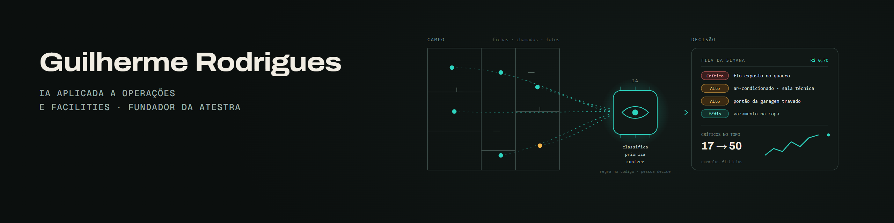

## Guilherme Rodrigues

Engenheiro eletricista e coordenador de contratos de manutenção predial. Construo o **[Atestra](https://atestra.com.br)**: software que confere o preço do pregão, o plano das equipes e a ficha de campo de contratos de serviço terceirizado.

Belo Horizonte · Python · TypeScript · PostgreSQL · IA aplicada

---

### Atestra

| Produto | O que faz |
|---|---|
| **[Scope](https://atestra.com.br/scope)** | Monta a planilha de custos do pregão no modelo da IN 5, com a escada de lances e a conferência da habilitação |
| **[Way](https://atestra.com.br/way)** | Dimensiona equipes e rotas de contratos com muitas unidades: estrada, pernoite e o que cabe no mês |
| **[Audit](https://atestra.com.br/audit)** | Confere fichas de PMOC, rondas, inspeções e notas fiscais contra as regras do contrato |

Os três nasceram da rotina de coordenação de um contrato real. Código privado; demonstrações sem cadastro no site.

React · FastAPI · PostgreSQL com Row-Level Security · Docker · Claude

---

### IA em operação

Casos que rodam com dado real num contrato de manutenção predial (detalhes no [portfólio](https://guihrodriguess.github.io/#operacao)):

- **Triagem de chamados com IA**, em rotina semanal: classificação com probabilidade, regra no código, cerca de R$ 0,70 por semana. [Laboratório com chamados fictícios](https://guihrodriguess.github.io/jev.html).
- **Auditoria de fichas de campo**: 426 relatórios de PMOC em 10 meses e 48.719 fotos indexadas contra reuso.
- **Assistente de contrato com RAG** no Microsoft Teams, com fonte citada e dados pessoais mascarados.
- **Sistema de admissão** com regra no banco (PostgreSQL com RLS): 1.115 testes de banco e zero erros com 100 pessoas simultâneas.

---

### Projetos públicos

- **[ai-engineering-portfolio](https://github.com/guihrodriguess/ai-engineering-portfolio)**: cinco sistemas de IA levados além da demo (RAG com avaliação, agente com controle de execução, pipeline de classificação, fila assíncrona, app multi-tenant com RLS real).
- **[python-facility-tools](https://github.com/guihrodriguess/python-facility-tools)**: scripts de apoio à gestão de manutenção predial.

---

### Formação contínua

Anthropic Academy (2026): Claude API, Claude Code, Model Context Protocol, Agent Skills, Subagents, AI Fluency.

---

### Contato

[Portfólio](https://guihrodriguess.github.io) · [LinkedIn](https://linkedin.com/in/guilherme-rodrigues-a532077b/) · [Atestra no LinkedIn](https://linkedin.com/company/atestra-br) · contato@atestra.com.br
